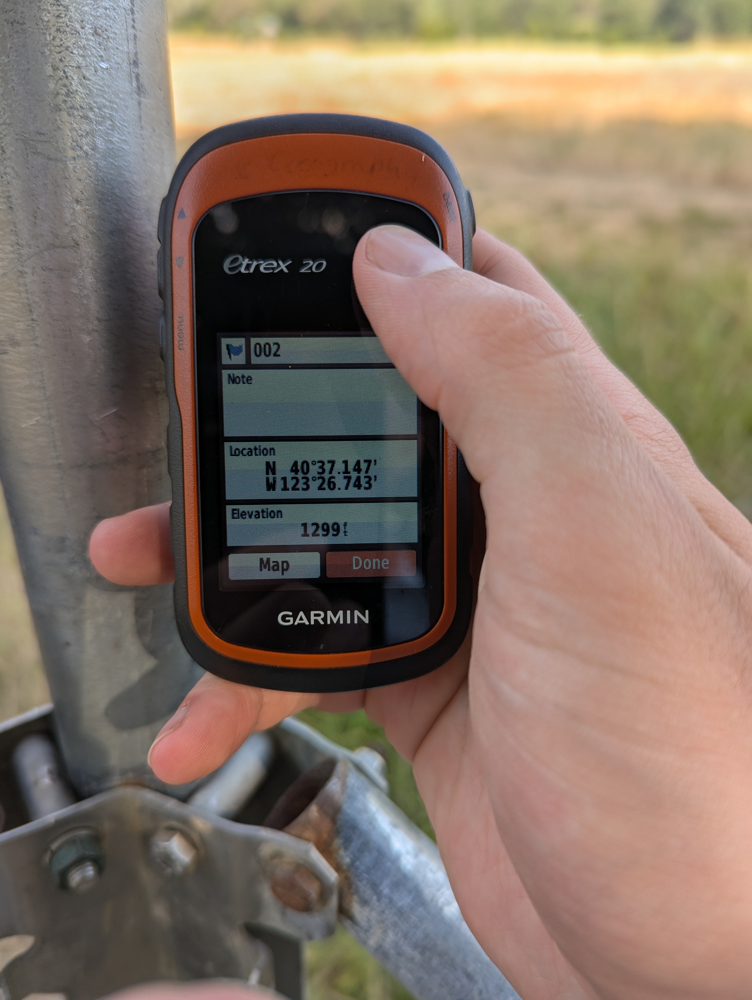

# DustTrak II Data

## Overview

This dataset contains aerosol mass concentration measurements collected using a TSI DustTrak II Aerosol Monitor during a prescribed burn experiment. The DustTrak II reports aerosol mass concentration using a light-scattering photometer.

The [processed data file](./dt_2025_06_10.csv) was created by organizing the raw DustTrak export into a simplified CSV format.

* The first 10 minutes were removed. Readings during this period reflected instrument deployment/setup rather than ambient conditions.
* The cleaned file retains the original 1-second sampling interval.
* The reported mass concentration values were not corrected using any calibration factor.

## Data Columns

The cleaned DustTrak file, [`dt_2025_06_10.csv`](./dt_2025_06_10.csv), contains one row per 1-second sample. Data collected during setup, corresponding to the first 10 minutes of the raw instrument export, were removed.

| Column        | Description   | Range / Note  |
|---------------|---------------|---------------|
| `datetime`   | Timestamp for each DustTrak sample in **Local Time**. The cleaned file begins at `2025-06-10 07:49:08` and ends at `2025-06-10 14:09:18`.   | `YYYY-MM-DD HH:MM:SS` (LT) |
| `Elapsed Time [s]` | Elapsed time from the start of the raw DustTrak test. The cleaned file begins at elapsed time `601` seconds because the first 600 seconds were removed. | Seconds (s) |
| `Mass [mg/m3]`    | Aerosol mass concentration reported by the DustTrak II. | mg m-3    |
| `Alarms`| Instrument alarm flag for each sample. Blank values indicate no reported alarm for that sample.  | Blank in this file |
| `Errors` | Instrument error flag for each sample. Blank values indicate no reported error for that sample. | Blank in this file |

## Instrument Information

*Basic instrument information from the raw DustTrak export.*

| Field            | Value                |
| ---------------- | -------------------- |
| Instrument       | DustTrak II          |
| Model            | TSI DustTrak II 8530 |
| Serial Number    | 8530183103           |
| Firmware Version | 3.7                  |
| Calibration Date | 2018-08-02           |
| Test Name        | BURN TRIAL_003       |

## Sampling Information

*This information is from the raw file, `BURN TRIAL_003.csv`. The cleaned data file, `dt_2025_06_10.csv`, has been clipped to remove the first 10 minutes during setup.*

| Field                           | Value                       |
| ------------------------------- | --------------------------- |
| Test Start Date                 | 2025-06-10                  |
| Test Start Time                 | 07:39:07 AM                 |
| Test Length                     | 0 days, 6 hours, 30 minutes |
| Test Interval                   | 1 second                    |
| Number of Samples, raw file     | 23,411                      |
| Number of Samples, cleaned file | 22,811                      |

## Instrument Settings

| Field                | Value | Note                                                          |
| -------------------- | ----- | ------------------------------------------------------------- |
| Photometric User Cal | 1.00  | Factory/default photometric calibration factor                |
| Flow User Cal        | 0.00  | User flow calibration value reported by the instrument export |
| Errors               | Blank | No test-level error was reported in the raw header            |

## Location and Deployment

| Field | Value |
|---|---|
| Latitude | N 40°37.147' |
| Longitude | W 123°26.743' |
| Instrument height | ~2 m above ground level |

## Data Quality Notes

None at this time.

### Alarms and Errors

No alarms or errors were reported in the cleaned data file. The raw file header also does not report test-level errors.

## Notes for Analysis

* Use `Mass [mg/m3]` as the DustTrak-reported aerosol mass concentration.
* Values are reported in mg m-3.
* The cleaned file begins 10 minutes after the raw test start time.
* The timestamps are in local time.
* The DustTrak data are useful for analyzing temporal changes in smoke aerosol loading, plume timing, and relative concentration changes during the burn.

