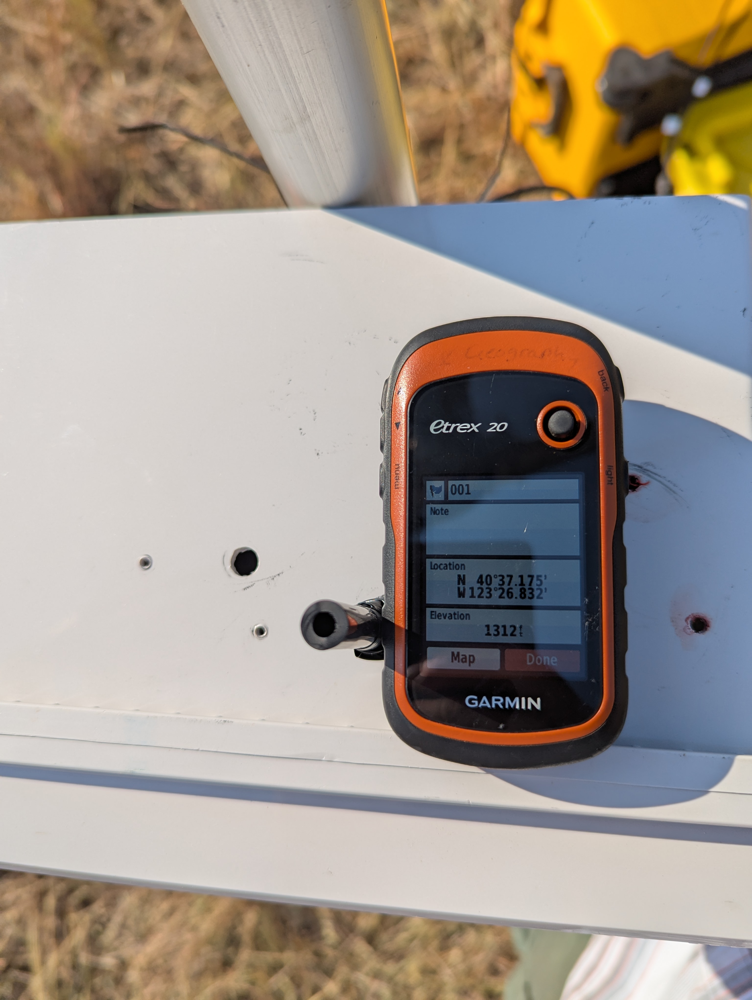

# Optical Particle Sizer Data

## Overview

This dataset contains aerosol particle size distribution measurements collected using a TSI Optical Particle Sizer during a prescribed burn experiment. The instrument records particle number concentrations across 16 optical size channels at 1-second resolution.

The [processed data file](./ops_2025_06_10.csv) was created by organizing the raw OPS export into a simplified CSV format. 
- The first 10 minutes were removed. Readings during this period reflected instrument deployment/setup rather than ambient conditions.

## Data Columns

The cleaned OPS file, [`ops_2025_06_10.csv`](./ops_2025_06_10.csv), contains one row per 1-second sample. Data collected during setup (first 10 minutes) were removed from the raw instrument export. ***Deadtime correction was not used***.

| Column |   Description   | Range / Note  |
| ----------|--------------| ----------------|
| `datetime` | Timestamp for each OPS sample in **Local Time**. The cleaned file begins at `2025-06-10 08:05:54` and ends at `2025-06-10 13:39:24`.  | `YYYY-MM-DD HH:MM:SS` (LT)   |
| `Bin 1`    | Particle number concentration (# cm<sup>-3</sup>) for the first OPS size bin.                   | 0.300–0.374 µm  |
| `Bin 2`    | Particle number concentration (# cm<sup>-3</sup>) for the second OPS size bin.                  | 0.374–0.465 µm  |
| `Bin 3`    | Particle number concentration (# cm<sup>-3</sup>) for the third OPS size bin.                   | 0.465–0.579 µm  |
| `Bin 4`    | Particle number concentration (# cm<sup>-3</sup>) for the fourth OPS size bin.                  | 0.579–0.721 µm  |
| `Bin 5`    | Particle number concentration (# cm<sup>-3</sup>) for the fifth OPS size bin.                   | 0.721–0.897 µm  |
| `Bin 6`    | Particle number concentration (# cm<sup>-3</sup>) for the sixth OPS size bin.                   | 0.897–1.117 µm  |
| `Bin 7`    | Particle number concentration (# cm<sup>-3</sup>) for the seventh OPS size bin.                 | 1.117–1.391 µm  |
| `Bin 8`    | Particle number concentration (# cm<sup>-3</sup>) for the eighth OPS size bin.                  | 1.391–1.732 µm  |
| `Bin 9`    | Particle number concentration (# cm<sup>-3</sup>) for the ninth OPS size bin.                   | 1.732–2.156 µm  |
| `Bin 10`   | Particle number concentration (# cm<sup>-3</sup>) for the tenth OPS size bin.                   | 2.156–2.685 µm  |
| `Bin 11`   | Particle number concentration (# cm<sup>-3</sup>) for the eleventh OPS size bin.                | 2.685–3.343 µm  |
| `Bin 12`   | Particle number concentration (# cm<sup>-3</sup>) for the twelfth OPS size bin.                 | 3.343–4.162 µm  |
| `Bin 13`   | Particle number concentration (# cm<sup>-3</sup>) for the thirteenth OPS size bin.              | 4.162–5.182 µm  |
| `Bin 14`   | Particle number concentration (# cm<sup>-3</sup>) for the fourteenth OPS size bin.              | 5.182–6.451 µm  |
| `Bin 15`   | Particle number concentration (# cm<sup>-3</sup>) for the fifteenth OPS size bin.               | 6.451–8.031 µm  |
| `Bin 16`   | Particle number concentration (# cm<sup>-3</sup>) for the sixteenth OPS size bin.               | 8.031–10.000 µm |
| `Bin 17`   | Additional bin column. From manual `B-3`: All particles greater than last bin upper boundary.   | 10.000+ µm      |
| `Deadtime (s)`| Amount of time unit was not detecting particles for each sample.                             | Seconds (s)   | 
| `Errors`   | Instrument error flag for each sample. Blank values indicate no reported error for that sample. | Blank or `Coincidence Error` |
| `Phase`    | Burn-period label assigned during processing.                                                   | `Pre-burn`, `Burn`, or `Post-burn` |

### Notes on Bin Columns

The OPS metadata reports 16 enabled size channels with bin cut points from 0.300 µm to 10.000 µm. These cut points define the 16 configured particle size intervals.

The raw and cleaned CSV files also contain a `Bin 17` column. This column is an overflow channel for particles larger than the upper boundary of Bin 16, or greater than 10.000 µm. `Bin 17` should be retained separately and should not be combined with `Bin 16`.

For future deployments, bin cut points could be configured to better separate fine- and coarse-mode particle size ranges.

___
## Instrument Information
*Basic instrument information.*

| Field | Value |
|---|---|
| Instrument | Optical Particle Sizer |
| Model | [TSI OPS 3330](https://tsi.com/getmedia/9728dd3d-5528-4621-9877-a116ee742528/3330_5001323_Web?ext=.pdf) |
| Serial Number | 3330142801 |
| Firmware Version | 1.4 |
| Calibration Date | 2018-07-03 |
| Protocol Name/Number | TEST_001 |

## Sampling Information
*This is from the [raw file](../../00_raw/OPS/2025_06_10-07_55_53-TEST_001.csv). The [cleaned data](./ops_2025_06_10.csv) has been clipped to remove the first 10 minutes during setup, so you will notice the processed data is 10 minutes shorter.*

| Field | Value |
|---|---|
| Test Start Date | 2025-06-10 |
| Test Start Time | 07:55:53 |
| Test Length | 0 days, 5 hours, 43 minutes, 31 seconds |
| Sample Interval | 1 second |
| Number of Samples | 20,611 |
| Number of Channels Enabled | 16 |

## Other Default Instrument Settings

| Field | Value | Note |
|---|---|---|
| Alarm Threshold | 0.000 #/cm³ | Alarm set point. No alarms set.|
| Particle Density | 1.000 | Particle density used to calculate mass |
| Refractive Index | 0.000-0.000j | Zeros indicate RI was not used|
| Size Correction Factor | 0.000 | Zeros indicate Shape Correction Factor was not used|
| Flow Calibration Factor | 1.000 | |
| Dead Time Correction Factor | 1.000 | Used in Deadtime correction Calculation |
| Errors | Coincidence Error | Errors will be `;` separated and could be: "Laser Error"; "Filter Warning"; "Coincidence Error"; "Test Stopped from Flow Block" |

## Location and Deployment

| Field | Value |
|---|---|
| Latitude | N 40°37.175' |
| Longitude | W 123°26.832' |
| Instrument height | ~1 m above ground level |



## Data Quality Notes

The instrument metadata reports the following error flag:

### Coincidence Error
Coincidence error occurs when more than one particle passes through the optical sensing volume at nearly the same time, which can cause particle counts and/or particle sizing to be biased. This is most likely during periods of high aerosol concentration, such as dense smoke plumes from the prescribed burn.

Users should treat high-concentration periods with caution. These values are retained as observations from the burn period, but coincidence error may bias particle counts and/or size distributions during *dense* smoke periods.

## Particle Size Bins
***Working on getting a confirmation on this if the lower/upper cut points are inclusive or exclusive, but showing what the manual shows***
| Bin | Lower Cut Point (µm) | Upper Cut Point (µm) |
| --: | -------------------: | -------------------: |
|   1 |                0.300 |                0.374 |
|   2 |                0.374 |                0.465 |
|   3 |                0.465 |                0.579 |
|   4 |                0.579 |                0.721 |
|   5 |                0.721 |                0.897 |
|   6 |                0.897 |                1.117 |
|   7 |                1.117 |                1.391 |
|   8 |                1.391 |                1.732 |
|   9 |                1.732 |                2.156 |
|  10 |                2.156 |                2.685 |
|  11 |                2.685 |                3.343 |
|  12 |                3.343 |                4.162 |
|  13 |                4.162 |                5.182 |
|  14 |                5.182 |                6.451 |
|  15 |                6.451 |                8.031 |
|  16 |                8.031 |               10.000 |
|  17 |              > 10.0   |     Anything greater |

***Bin 17*** is overflow, and contains anything that got through the filter, but was estimated to be larger than 10.0 µm


___
<!--
here is the raw output from the device...
```
'Bin Cut Points': {1: 0.3,
   2: 0.374,
   3: 0.465,
   4: 0.579,
   5: 0.721,
   6: 0.897,
   7: 1.117,
   8: 1.391,
   9: 1.732,
  10: 2.156,
  11: 2.685,
  12: 3.343,
  13: 4.162,
  14: 5.182,
  15: 6.451,
  16: 8.031,
  17: 10.0}
  ```
  -->

